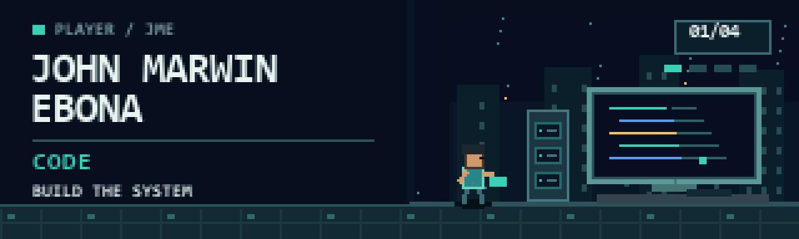

  

   

  
<strong>Software engineering × business analysis × data &amp; risk</strong>

  <a href="https://johnmarwin.app/">Portfolio</a> ·
  <a href="https://evidentia-ph.netlify.app/">Try Evidentia</a> ·
  <a href="https://route2zero.netlify.app/">Explore Route2Zero</a> ·
  <a href="https://www.linkedin.com/in/marwin-ebona">LinkedIn</a>

---

### The short version

I'm **John Marwin Ebona**, a Computer Science student majoring in **Intelligent Agents** at the Technological Institute of the Philippines (expected 2028). I build software and analytical systems that help people make decisions they can explain, test, and revisit.

My work crosses deployed business operations, financial risk, applied machine learning, and public-interest tools. I'm also interested in **banking and private equity**—especially how clean data, controls, commercial research, and financial models support sound decisions. That is a career direction, not a claim of employment in those fields.

### By the numbers

| **20,875** | **50,000+** | **1,522** | **214** |
| :---: | :---: | :---: | :---: |
| Records validated in an Evidentia run | Wallets screened by a payout-risk engine | Metro Manila corridor records ranked by Route2Zero | Automated tests behind Evidentia |

### Selected systems

**01 / [Evidentia](https://evidentia-ph.netlify.app/)** · live analytics product  
*Decision:* Can we trust these figures enough to act on them?  
*My work:* Sole designer, developer, and analyst. Built 40+ data-quality checks, reconciliation, forecasting, scenario analysis, named sign-off, and a hash-chained audit trail.

**02 / [Sentinel Ledger](https://github.com/qjmre23/Real-Time-Stablecoin-Payout-Risk-Scoring-System)** · payout-risk engine  
*Decision:* Should a payout be allowed, reviewed, or blocked?  
*My work:* Built scoring across 54 tokens with versioned ML models, leakage-safe validation, rollback, graph signals, and plain-language reasons.

**03 / [JOAP Hardware ERP](https://johnmarwin.app/)** · deployed for a live business  
*Decision:* What is in stock, what has sold, and what needs attention?  
*My work:* Led delivery of inventory, order, billing, accounting, and revenue-forecasting workflows. The [public JOAP supplier-management repository](https://github.com/qjmre23/JOAP---SOFTWARE-ENGINEERING) is a separate course project.

**04 / [PAMANA](https://github.com/qjmre23/Henkel-Lock-tight-Pamana)** · Henkel Loctite ideathon  
*Decision:* Can an AI-assisted repair concept make commercial sense?  
*My work:* Led the team, estimated build and operating costs, and owned the five-year financial model and ROI case; built a Next.js and Gemini Vision prototype.

### Achievements unlocked

| Milestone | Role and proof |
| :--- | :--- |
| **Top 6 national finalist** · DOST Game Development Challenge 2026 | Technical lead and code-defense speaker. |
| **Top 54 finalist** · eGovPH Hackathon 2026 | Built an AI passport-concierge concept with five guided application flows. |
| **Six-country market research** · [ANI](https://github.com/qjmre23/ANI-AI-Farm-to-Market-Platform) | Led research across South and Southeast Asian markets to shape a farm-to-market platform. |
| **Climate decision support** · [Route2Zero](https://github.com/qjmre23/Route2Zero) | Led a transparent electrification shortlist and auto-generated policy briefs for the AI × City Climate Action Hackathon, University of Cambridge track. |
| **Food-safety risk screening** · [PigmeatSafeAI](https://github.com/qjmre23/PIGMEATSAFEAI) | Deputy technical lead at Vingroup Vietnam Hackathon 2026; combined vision, weather, transport, and supplier signals into SELL / HOLD / REJECT recommendations. |

### More code to explore

| Public repository | What to look for |
| :--- | :--- |
| [Route2Zero](https://github.com/qjmre23/Route2Zero) · [live demo](https://route2zero.netlify.app/) | Adjustable index for emissions, equity, grid feasibility, and operator readiness; 1,522 route-direction records. |
| [ANI · Farm to Market](https://github.com/qjmre23/ANI-AI-Farm-to-Market-Platform) | Pilot-stage, offline field capture, produce grading, buyer coordination, and traceability. |
| [PAMANA](https://github.com/qjmre23/Henkel-Lock-tight-Pamana) | AI-assisted repair guidance, deterministic product matching, and safety gates. |
| [EvacuWay](https://github.com/qjmre23/EvacuWay) | Reproducible flood-evacuation routing simulation with interactive maps and equity measures. |
| [PigmeatSafeAI](https://github.com/qjmre23/PIGMEATSAFEAI) | Mobile and backend prototype for contextual food-safety risk screening. |
| [JOAP Supplier Management](https://github.com/qjmre23/JOAP---SOFTWARE-ENGINEERING) | Course project for procurement, reorder alerts, approvals, and forecasting. |

### Toolkit

| Business & analysis | Data & risk | Engineering |
| :--- | :--- | :--- |
| Market research · financial modeling · cost estimation · ROI · KPI design | Python · SQL · Excel · forecasting · reconciliation · risk scoring | TypeScript · React · Next.js · FastAPI · Flutter · Docker |
| Requirements · user journeys · presenting to judges | Pandas · scikit-learn · XGBoost · LightGBM · model validation | PostgreSQL · MongoDB · AWS · GitHub Actions · Playwright |

### GitHub activity

  
  
   
  

These third-party widgets reflect public activity and may lag. GitHub's contribution calendar also includes anonymized private contributions.

---

  <strong>Open to internships and collaboration in software, analytics, risk, and business.</strong> 
  <a href="https://johnmarwin.app/">See the full portfolio and get in touch</a>

