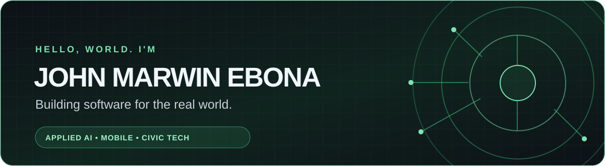

  

  
<strong>Data analytics · Applied machine learning · Software engineering</strong>

  
Computer Science student at T.I.P., majoring in Intelligent Agents. I turn messy data and business problems into decisions people can defend.

  <a href="https://johnmarwin.app/">Portfolio</a> ·
  <a href="https://viscodeai.netlify.app/">VIS/CODE</a> ·
  <a href="https://evidentia-ph.netlify.app/">Evidentia</a> ·
  <a href="https://github.com/qjmre23?tab=repositories">Repositories</a>

---

### A few numbers behind the work

| 20,875 | 1,522 | Top 6 |
| :---: | :---: | :---: |
| Records validated in one Evidentia run | Metro Manila route-direction records screened by Route2Zero | National finalist, DOST Game Development Challenge 2026 |

### Live products

| Product | The problem it tackles |
| :--- | :--- |
| [**VIS/CODE ↗**](https://viscodeai.netlify.app/) | I founded VIS/CODE to turn codebases in 40+ languages into navigable architecture maps, with AI explanations tied to the code being viewed. |
| [**Evidentia ↗**](https://evidentia-ph.netlify.app/) | I designed and built an audit-ready analytics platform with 40+ data-quality checks, reconciliation, forecasts, scenario analysis, and a hash-chained audit trail. |

### What I'm building

I work across **Python, TypeScript, React, FastAPI, Flutter, and Dart**. My projects often connect a useful interface to the harder parts underneath: data pipelines, maps, offline access, explainable decisions, and real operational constraints.

| 🌾 Food systems | 🌀 Resilient cities | 🧰 Everyday operations |
| :--- | :--- | :--- |
| Help move harvests to buyers and make quality workflows more traceable. | Make disaster response and transport decisions easier to explore and explain. | Give small teams clearer tools for inventory, orders, and reporting. |

### Featured work

| Project | What it does | Built with |
| :--- | :--- | :--- |
| [**ANI · Farm to Market**](https://github.com/qjmre23/ANI-AI-Farm-to-Market-Platform) | Pilot-stage platform for produce grading, offline field capture, buyer coordination, and traceability. | FastAPI · React · Flutter · YOLO |
| [**Route2Zero**](https://github.com/qjmre23/Route2Zero) · [live](https://route2zero.netlify.app/) | Ranks potential e-jeepney corridors using climate, equity, grid, and operator-readiness factors, with assumptions visible. | Python · Geospatial data |
| [**EvacuWay**](https://github.com/qjmre23/EvacuWay) | Reproducible Metro Manila flood-evacuation routing simulation with an interactive dashboard and equity measures. | Python · FastAPI · React · Leaflet |
| [**SAGIP PH**](https://github.com/qjmre23/EAyudaPH) | Android-first disaster and assistance **concept** with explainable priority scoring. Uses synthetic demo data; it is not a government service. | React Native · Expo · TypeScript |
| [**JOAP Hardware Trading**](https://github.com/qjmre23/JOAP---SOFTWARE-ENGINEERING) | Inventory, order, billing, accounting, and reporting workflows for a live hardware business. | TypeScript · React · MongoDB |
| [**PigmeatSafeAI**](https://github.com/qjmre23/PIGMEATSAFEAI) | Prototype mobile and backend pipeline for pork-image screening and contextual risk information. | Flutter · FastAPI · YOLO |

### Tools I reach for

  
  
  
  
  
  
  
  
  
  

### At a glance

  
  
   
  

These images are generated from public GitHub activity and may refresh at different times. The contribution calendar below is GitHub's own record.

---

  <strong>Open to internship and collaboration opportunities.</strong> 
  <a href="https://johnmarwin.app/">Portfolio and contact</a> · <a href="https://github.com/qjmre23?tab=repositories">All repositories</a>

